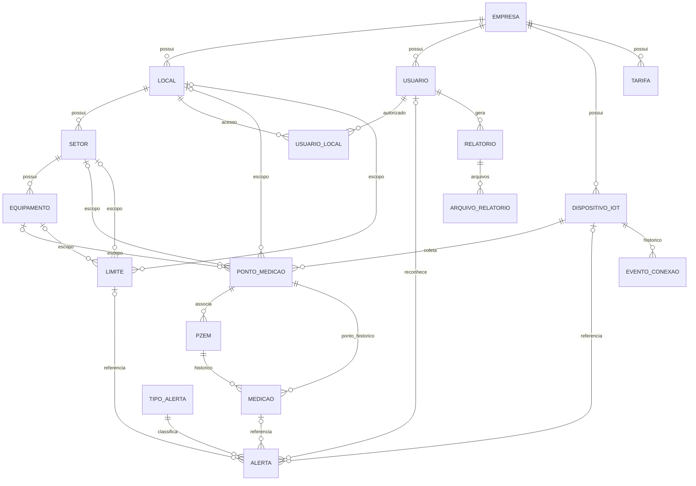

# Watt Vision — referência do banco de dados

Análise estática em 16/11/2026 do arquivo `/Users/25203646/Documents/BD/Script Completo.rtf`. SHA-256 do original: `26bf14a3b741504d83d850983bae127a90401e11b028cc3bfea50cbabe6ef9ae`. Não há commit do script identificado nesta análise. Backend comparado: `db9d479414ffd0e0ad427ea560ab0b0d9bd3c955`; caminhos e catálogo HTTP em [BACKEND_REFERENCE.md](BACKEND_REFERENCE.md).

## 1. Método, alcance e identificação

Extração textual com `textutil -convert txt -stdout` sobre o RTF original, sem alterá-lo. Texto tratado em memória; para a primeira leitura, INSERTs foram omitidos antes da saída. A documentação abaixo deriva somente de DDL, views e rotinas. Nenhum seed, registro, contato, senha ou hash de autenticação foi copiado. Nenhuma conexão ao banco, execução de SQL ou migração realizada. Não foi criada cópia integral do SQL no projeto.

O cabeçalho declara **MySQL 8.0+**; utiliza InnoDB, utf8mb4 e banco `db_watt_vision` com collation utf8mb4_unicode_ci. Há **19 tabelas, 12 views, uma procedure e um trigger**; nenhuma stored function, evento agendado ou particionamento encontrado. A versão exata de MySQL e a aplicação real de CHECK precisam ser confirmadas no ambiente autorizado; o script não prova o schema de produção.

O comentário chama a instalação de idempotente/recriação, porém o conteúdo lido usa CREATE DATABASE/CREATE TABLE sem IF NOT EXISTS e não contém DROP correspondente: essa promessa não é sustentada pelos comandos presentes. Não executar para verificar. Extração de RTF contém espaços não separáveis; somente o processamento textual para documentação normalizou esses espaços, sem editar a origem.

## 2. Dicionário de tabelas e colunas

Notação: todas as colunas estão listadas com tipo e modificadores explícitos do script. Ausência de NOT NULL em coluna comum permite NULL; PK implica não nulidade. BOOLEAN é a declaração usada no SQL. `id` é PK INT AUTO_INCREMENT, exceto onde indicado (históricos BIGINT, configurações INT sem AUTO_INCREMENT). CHECKs e índices estão consolidados após o dicionário. Não presumir campos de tabelas que não constem aqui.

### tbl_empresa

Organizações e status cadastral.

| Coluna | Tipo | Modificadores explícitos |
| --- | --- | --- |
| id | INT | AUTO_INCREMENT PRIMARY KEY |
| razao_social | VARCHAR(150) | NOT NULL |
| nome_fantasia | VARCHAR(150) | — |
| cnpj | VARCHAR(18) | NOT NULL UNIQUE |
| email | VARCHAR(100) | — |
| telefone | VARCHAR(20) | — |
| status | VARCHAR(20) | NOT NULL DEFAULT 'Ativa' |

### tbl_local

Unidades físicas pertencentes a uma empresa.

| Coluna | Tipo | Modificadores explícitos |
| --- | --- | --- |
| id | INT | AUTO_INCREMENT PRIMARY KEY |
| id_empresa | INT | NOT NULL |
| codigo | VARCHAR(20) | NOT NULL UNIQUE |
| nome | VARCHAR(100) | NOT NULL |
| endereco | VARCHAR(255) | — |
| responsavel | VARCHAR(100) | — |
| descricao | VARCHAR(255) | — |
| status | VARCHAR(20) | NOT NULL DEFAULT 'Ativo' |

### tbl_setor

Divisões de um local.

| Coluna | Tipo | Modificadores explícitos |
| --- | --- | --- |
| id | INT | AUTO_INCREMENT PRIMARY KEY |
| id_local | INT | NOT NULL |
| codigo | VARCHAR(20) | NOT NULL UNIQUE |
| nome | VARCHAR(100) | NOT NULL |
| responsavel | VARCHAR(100) | — |
| descricao | VARCHAR(255) | — |
| status | VARCHAR(20) | NOT NULL DEFAULT 'Ativo' |

### tbl_equipamento

Ficha cadastral vinculada a setor.

| Coluna | Tipo | Modificadores explícitos |
| --- | --- | --- |
| id | INT | AUTO_INCREMENT PRIMARY KEY |
| id_setor | INT | NOT NULL |
| codigo | VARCHAR(20) | NOT NULL UNIQUE |
| nome | VARCHAR(100) | NOT NULL |
| tipo_equipamento | VARCHAR(100) | — |
| fabricante | VARCHAR(100) | — |
| modelo | VARCHAR(100) | — |
| numero_serie | VARCHAR(50) | — |
| descricao | VARCHAR(255) | — |
| potencia_nominal | DECIMAL(10,2) | — |
| tensao_nominal | DECIMAL(10,2) | — |
| data_instalacao | DATE | — |
| status | VARCHAR(20) | NOT NULL DEFAULT 'Ativo' |

### tbl_usuario

Identidade, empresa, perfil e situação do usuário.

| Coluna | Tipo | Modificadores explícitos |
| --- | --- | --- |
| id | INT | AUTO_INCREMENT PRIMARY KEY |
| id_empresa | INT | NOT NULL |
| nome | VARCHAR(100) | NOT NULL |
| email | VARCHAR(100) | NOT NULL UNIQUE |
| senha | VARCHAR(255) | NOT NULL |
| perfil | VARCHAR(20) | NOT NULL DEFAULT 'Gestor' |
| status | VARCHAR(20) | NOT NULL DEFAULT 'Ativo' |
| data_cadastro | DATETIME | NOT NULL DEFAULT CURRENT_TIMESTAMP |
| ultimo_acesso | DATETIME | NULL |

### tbl_usuario_local

Autorizações de acesso de usuários a locais.

| Coluna | Tipo | Modificadores explícitos |
| --- | --- | --- |
| id | INT | AUTO_INCREMENT PRIMARY KEY |
| id_usuario | INT | NOT NULL |
| id_local | INT | NOT NULL |

### tbl_dispositivo_iot

Identidade, rede e comunicação do ESP32/dispositivo.

| Coluna | Tipo | Modificadores explícitos |
| --- | --- | --- |
| id | INT | AUTO_INCREMENT PRIMARY KEY |
| id_empresa | INT | NOT NULL |
| nome | VARCHAR(100) | NOT NULL |
| identificador | VARCHAR(50) | NOT NULL UNIQUE |
| mac_address | VARCHAR(17) | NOT NULL UNIQUE |
| modelo | VARCHAR(100) | — |
| numero_serie | VARCHAR(50) | — |
| ip | VARCHAR(45) | — |
| versao_firmware | VARCHAR(20) | — |
| data_instalacao | DATE | — |
| ssid | VARCHAR(100) | — |
| broker | VARCHAR(100) | — |
| port | INT | — |
| topic | VARCHAR(150) | — |
| client_id | VARCHAR(100) | — |
| tx_interval_sec | INT | — |
| wifi | BOOLEAN | NOT NULL DEFAULT FALSE |
| mqtt | BOOLEAN | NOT NULL DEFAULT FALSE |
| status | VARCHAR(20) | NOT NULL DEFAULT 'offline' |
| data_comunicacao | DATETIME | — |

### tbl_ponto_medicao

Escopo monitorado e dispositivo responsável.

| Coluna | Tipo | Modificadores explícitos |
| --- | --- | --- |
| id | INT | AUTO_INCREMENT PRIMARY KEY |
| nome | VARCHAR(100) | NOT NULL |
| descricao | VARCHAR(150) | — |
| data_instalacao | DATETIME | NULL |
| status | VARCHAR(20) | NOT NULL DEFAULT 'Ativo' |
| id_local | INT | NULL |
| id_setor | INT | NULL |
| id_equipamento | INT | NULL |
| id_dispositivo_iot | INT | NOT NULL |

### tbl_pzem

Sensor associado a um ponto de medição.

| Coluna | Tipo | Modificadores explícitos |
| --- | --- | --- |
| id | INT | AUTO_INCREMENT PRIMARY KEY |
| id_ponto_medicao | INT | NOT NULL |
| numero_serie | VARCHAR(50) | NOT NULL UNIQUE |
| modelo | VARCHAR(50) | NOT NULL DEFAULT 'PZEM-004T' |
| versao | VARCHAR(20) | — |
| data_instalacao | DATE | — |
| status | VARCHAR(20) | NOT NULL DEFAULT 'Ativo' |

### tbl_medicao

Histórico de leituras elétricas, com ponto registrado na própria leitura.

| Coluna | Tipo | Modificadores explícitos |
| --- | --- | --- |
| id | BIGINT | AUTO_INCREMENT PRIMARY KEY |
| id_pzem | INT | NOT NULL |
| id_ponto_medicao | INT | NOT NULL |
| data_hora | DATETIME | NOT NULL |
| tensao | DECIMAL(10,2) | — |
| corrente | DECIMAL(10,3) | — |
| potencia_ativa | DECIMAL(10,2) | — |
| energia_acumulada | DECIMAL(12,3) | — |
| frequencia | DECIMAL(5,2) | — |
| fator_potencia | DECIMAL(5,3) | — |

### tbl_tarifa

Preço por kWh e intervalo de vigência por empresa.

| Coluna | Tipo | Modificadores explícitos |
| --- | --- | --- |
| id | INT | AUTO_INCREMENT PRIMARY KEY |
| id_empresa | INT | NOT NULL |
| descricao | VARCHAR(100) | NOT NULL |
| valor_kwh | DECIMAL(10,4) | NOT NULL |
| data_inicial | DATE | NOT NULL |
| data_final | DATE | NULL |
| status | VARCHAR(20) | NOT NULL DEFAULT 'Ativa' |

### tbl_config_comunicacao

Parâmetros corporativos de comunicação, linha única prevista.

| Coluna | Tipo | Modificadores explícitos |
| --- | --- | --- |
| id | INT | PRIMARY KEY |
| tempo_offline_minutos | INT | NOT NULL DEFAULT 5 |
| tempo_instavel_minutos | INT | NOT NULL DEFAULT 2 |
| tempo_reconexao_estavel_minutos | INT | NOT NULL DEFAULT 3 |
| gerar_alarme_offline | BOOLEAN | NOT NULL DEFAULT TRUE |
| gerar_alarme_reconexao | BOOLEAN | NOT NULL DEFAULT TRUE |
| registrar_historico | BOOLEAN | NOT NULL DEFAULT TRUE |
| intervalo_verificacao_minutos | INT | NOT NULL DEFAULT 1 |

### tbl_config_sistema

Configuração global de apresentação/empresa, linha única prevista.

| Coluna | Tipo | Modificadores explícitos |
| --- | --- | --- |
| id | INT | PRIMARY KEY |
| nome_empresa | VARCHAR(150) | NOT NULL DEFAULT 'Watt Vision' |
| fuso_horario | VARCHAR(50) | NOT NULL DEFAULT 'America/Sao_Paulo' |
| formato_data | VARCHAR(20) | NOT NULL DEFAULT 'DD/MM/YYYY' |
| tema | VARCHAR(20) | NOT NULL DEFAULT 'Escuro' |
| unidade_energia | VARCHAR(10) | NOT NULL DEFAULT 'kWh' |

### tbl_tipo_alerta

Catálogo de tipos e categorias de alarme.

| Coluna | Tipo | Modificadores explícitos |
| --- | --- | --- |
| id | INT | AUTO_INCREMENT PRIMARY KEY |
| nome | VARCHAR(50) | NOT NULL UNIQUE |
| categoria | VARCHAR(20) | NOT NULL |
| descricao | VARCHAR(255) | — |

### tbl_limite

Regra cadastrada para uma grandeza e um único escopo.

| Coluna | Tipo | Modificadores explícitos |
| --- | --- | --- |
| id | INT | AUTO_INCREMENT PRIMARY KEY |
| descricao | VARCHAR(150) | — |
| grandeza | VARCHAR(20) | NOT NULL |
| operador | VARCHAR(2) | NOT NULL |
| valor | DECIMAL(10,3) | NOT NULL |
| severidade | VARCHAR(20) | NOT NULL |
| periodo_inicial | DATE | NULL |
| periodo_final | DATE | NULL |
| ativa | BOOLEAN | NOT NULL DEFAULT TRUE |
| id_local | INT | NULL |
| id_setor | INT | NULL |
| id_equipamento | INT | NULL |

### tbl_alerta

Ocorrência, valores e reconhecimento.

| Coluna | Tipo | Modificadores explícitos |
| --- | --- | --- |
| id | BIGINT | AUTO_INCREMENT PRIMARY KEY |
| id_tipo_alerta | INT | NOT NULL |
| id_limite | INT | NULL |
| id_dispositivo_iot | INT | NULL |
| id_medicao | BIGINT | NULL |
| valor_detectado | DECIMAL(12,3) | — |
| valor_limite | DECIMAL(12,3) | — |
| severidade | VARCHAR(20) | NOT NULL |
| mensagem | VARCHAR(255) | — |
| data_hora | DATETIME | NOT NULL DEFAULT CURRENT_TIMESTAMP |
| status | VARCHAR(20) | NOT NULL DEFAULT 'ativo' |
| reconhecido_por | INT | NULL |
| data_reconhecimento | DATETIME | NULL |

### tbl_evento_conexao

Histórico de desconexão/reconexão, sem API identificada.

| Coluna | Tipo | Modificadores explícitos |
| --- | --- | --- |
| id | BIGINT | AUTO_INCREMENT PRIMARY KEY |
| id_dispositivo_iot | INT | NOT NULL |
| evento | VARCHAR(20) | NOT NULL |
| data_hora | DATETIME | NOT NULL DEFAULT CURRENT_TIMESTAMP |
| duracao_segundos | INT | NULL |

### tbl_relatorio

Metadados de relatório e parâmetros JSON.

| Coluna | Tipo | Modificadores explícitos |
| --- | --- | --- |
| id | INT | AUTO_INCREMENT PRIMARY KEY |
| id_usuario | INT | NOT NULL |
| titulo | VARCHAR(150) | NOT NULL |
| tipo | VARCHAR(20) | NOT NULL |
| data_geracao | DATETIME | NOT NULL DEFAULT CURRENT_TIMESTAMP |
| parametros | JSON | — |

### tbl_arquivo_relatorio

Arquivos PDF/CSV associados a relatório.

| Coluna | Tipo | Modificadores explícitos |
| --- | --- | --- |
| id | INT | AUTO_INCREMENT PRIMARY KEY |
| id_relatorio | INT | NOT NULL |
| nome_arquivo | VARCHAR(150) | NOT NULL |
| formato | VARCHAR(10) | NOT NULL |
| caminho | VARCHAR(255) | NOT NULL |
| tamanho_bytes | INT | — |
| data_geracao | DATETIME | NOT NULL DEFAULT CURRENT_TIMESTAMP |

## 3. Integridade, unicidade e índices

Todas as FKs do script referenciam o `id` da tabela de destino. Sem ON DELETE/ON UPDATE explícito, não presumir cascata. PKs e UNIQUEs fornecem índices próprios; o script também declara os índices abaixo. InnoDB pode criar índices de apoio a FKs, mas não foram listados como índices explicitamente nomeados no script.

| Tema | Restrições efetivamente declaradas |
| --- | --- |
| Identidade | UNIQUE global em empresa.cnpj; local.codigo; setor.codigo; equipamento.codigo; usuario.email; dispositivo.identificador e mac_address; pzem.numero_serie; tipo_alerta.nome |
| Autorizações | UNIQUE (id_usuario,id_local); FK usuário/local com ON DELETE CASCADE; script não impõe por CHECK que usuário e local sejam da mesma empresa |
| Situação cadastral | Empresa/tarifa Ativa ou Inativa; local/setor/equipamento/usuário/ponto Ativo ou Inativo; usuário Administrador ou Gestor |
| Comunicação | Dispositivo online/offline/instavel/disponivel; PZEM Ativo/Inativo/Defeito; não confundir com regra de idade da view |
| Escopo de ponto e limite | Soma dos indicadores de id_local/id_setor/id_equipamento não nulos deve ser exatamente 1; FKs individuais não garantem que dispositivo e entidade tenham a mesma empresa |
| Histórico de medição | UNIQUE (id_pzem,data_hora); FKs independentes para sensor e ponto, sem constraint composta que comprove o vínculo entre os dois |
| Tarifas | data_final nula ou >= data_inicial; status válido; nenhum CHECK de valor positivo e nenhuma exclusão de sobreposição de vigência |
| Limites | grandeza tensao/corrente/potencia/energia; operador >,<,>=,<=; severidade meta/informativo/atencao/critico; período final nulo, inicial nulo ou final >= inicial; sem CHECK de valor >=0 |
| Tipos/alertas | categoria energetico/comunicacao; alerta informativo/atencao/critico e status ativo/reconhecido; sem resolvido |
| Eventos | desconectado/reconectado; FK dispositivo com ON DELETE CASCADE; duracao_segundos sem CHECK de não negatividade |
| Configurações | id=1 nas duas tabelas (restringe a no máximo uma linha, não garante existência); sistema aceita três formatos de data e tema Escuro/Claro |
| Relatórios | tipo historico/comparacao/previsibilidade; arquivo formato PDF/CSV; FK arquivo→relatório com ON DELETE CASCADE; relatório→usuário sem cascata explícita |

Índices nomeados explicitamente:

| Tabela | Índice | Colunas |
| --- | --- | --- |
| tbl_dispositivo_iot | idx_disp_status; idx_disp_data_com | status; data_comunicacao |
| tbl_pzem | idx_pzem_ponto | id_ponto_medicao |
| tbl_medicao | idx_medicao_data; idx_medicao_ponto_data; idx_medicao_pzem_data | data_hora; (id_ponto_medicao,data_hora); (id_pzem,data_hora) |
| tbl_tarifa | idx_tarifa_vigencia | (id_empresa,data_inicial,data_final) |
| tbl_alerta | idx_alerta_data; idx_alerta_status | data_hora; status |
| tbl_evento_conexao | idx_evento_disp_data; idx_evento_evento | (id_dispositivo_iot,data_hora); evento |

O índice explícito de PZEM/data e o UNIQUE de medição usam as mesmas colunas. Sem auditoria de planos/volume, não concluir necessidade de removê-lo ou alterar o banco. Não há retenção, expurgo, partições, arquivo histórico ou resumo materializado no script.

### Inventário explícito de chaves estrangeiras

| Origem | Destino | Constraint | Ação declarada |
| --- | --- | --- | --- |
| tbl_local.id_empresa | tbl_empresa.id | fk_local_empresa | Sem ação explícita |
| tbl_setor.id_local | tbl_local.id | fk_setor_local | Sem ação explícita |
| tbl_equipamento.id_setor | tbl_setor.id | fk_equipamento_setor | Sem ação explícita |
| tbl_usuario.id_empresa | tbl_empresa.id | fk_usuario_empresa | Sem ação explícita |
| tbl_usuario_local.id_usuario | tbl_usuario.id | fk_ul_usuario | ON DELETE CASCADE |
| tbl_usuario_local.id_local | tbl_local.id | fk_ul_local | ON DELETE CASCADE |
| tbl_dispositivo_iot.id_empresa | tbl_empresa.id | fk_disp_empresa | Sem ação explícita |
| tbl_ponto_medicao.id_local | tbl_local.id | fk_pm_local | Sem ação explícita |
| tbl_ponto_medicao.id_setor | tbl_setor.id | fk_pm_setor | Sem ação explícita |
| tbl_ponto_medicao.id_equipamento | tbl_equipamento.id | fk_pm_equipamento | Sem ação explícita |
| tbl_ponto_medicao.id_dispositivo_iot | tbl_dispositivo_iot.id | fk_pm_dispositivo | Sem ação explícita |
| tbl_pzem.id_ponto_medicao | tbl_ponto_medicao.id | fk_pzem_ponto | Sem ação explícita |
| tbl_medicao.id_pzem | tbl_pzem.id | fk_medicao_pzem | Sem ação explícita |
| tbl_medicao.id_ponto_medicao | tbl_ponto_medicao.id | fk_medicao_ponto | Sem ação explícita |
| tbl_tarifa.id_empresa | tbl_empresa.id | fk_tarifa_empresa | Sem ação explícita |
| tbl_limite.id_local | tbl_local.id | fk_limite_local | Sem ação explícita |
| tbl_limite.id_setor | tbl_setor.id | fk_limite_setor | Sem ação explícita |
| tbl_limite.id_equipamento | tbl_equipamento.id | fk_limite_equipamento | Sem ação explícita |
| tbl_alerta.id_tipo_alerta | tbl_tipo_alerta.id | fk_alerta_tipo | Sem ação explícita |
| tbl_alerta.id_limite | tbl_limite.id | fk_alerta_limite | Sem ação explícita |
| tbl_alerta.id_dispositivo_iot | tbl_dispositivo_iot.id | fk_alerta_dispositivo | Sem ação explícita |
| tbl_alerta.id_medicao | tbl_medicao.id | fk_alerta_medicao | Sem ação explícita |
| tbl_alerta.reconhecido_por | tbl_usuario.id | fk_alerta_usuario | Sem ação explícita |
| tbl_evento_conexao.id_dispositivo_iot | tbl_dispositivo_iot.id | fk_evento_disp | ON DELETE CASCADE |
| tbl_relatorio.id_usuario | tbl_usuario.id | fk_relatorio_usuario | Sem ação explícita |
| tbl_arquivo_relatorio.id_relatorio | tbl_relatorio.id | fk_arquivo_relatorio | ON DELETE CASCADE |

## 4. Relacionamentos lógicos

O diagrama usa nomes abreviados para as tabelas `tbl_*`. Linhas representam FKs, inclusive opcionais; a exclusividade de escopo (local OU setor OU equipamento) é garantida pelo CHECK e não é totalmente expressa pelas arestas.

Configurações são tabelas sem FKs para empresa ou usuário. O nome de empresa nelas não substitui tbl_empresa nem é preferência pessoal por usuário. O ponto referencia exatamente um escopo; ancestrais devem ser resolvidos por equipamento→setor→local→empresa. Um ponto admite vários PZEMs; a estrutura não comprova relação um-para-um. tbl_medicao guarda tanto id_pzem quanto id_ponto_medicao, útil para preservar histórico após transferência do sensor; algumas views ignoram esse ponto histórico e usam vínculo atual.

## 5. Views e rotinas presentes

| Objeto | Responsabilidade e regra identificada |
| --- | --- |
| vw_ultima_medicao_pzem | PZEM/ponto atual com última leitura por ROW_NUMBER particionado por id_pzem, data_hora DESC,id DESC; LEFT JOIN preserva sensor sem leitura |
| vw_dashboard_resumo | contagens globais, soma de últimas potências /1000 e ROUND 2, COALESCE zero, contagem de alertas status ativo; não filtra empresa/usuário |
| vw_equipamentos_operacional | ficha do equipamento + setor/local/empresa por INNER JOIN; aliases equipamento,local,setor e status_equipamento |
| vw_alarmes_ativos | alertas ativos com tipo/categoria, limite, medição/PZEM/ponto e dispositivo; resolve origem por COALESCE; referências por leitura usam ponto atual do PZEM |
| vw_consumo_diario | LAG energia por PZEM em todo histórico, ordem data_hora,id; soma incrementos >=0, primeira leitura/reset contribuem 0; agrupa por DATE(data_hora), ROUND 3 |
| vw_consumo_mensal | soma consumo diário por sensor/ano/mês e contagem de amostras; não é armazenamento materializado |
| vw_custo_energia_mensal | consumo mensal * tarifa ativa da empresa no primeiro dia do mês, ROUND 4; resolve empresa pelo vínculo atual; múltiplas tarifas podem produzir múltiplas linhas |
| vw_conectividade_dispositivos | idade em segundos com NOW; nulo SEM COMUNICACAO; futuro HORARIO INVALIDO; <=120 s ONLINE; demais OFFLINE; não utiliza status cadastrado/configuração de comunicação |
| vw_resumo_conectividade | total e somas de online/offline/sem comunicação com COALESCE zero; horário inválido entra no total, sem contador dedicado |
| vw_dashboard_completo | CROSS JOIN dos resumos globais de dashboard e conectividade |
| vw_detalhes_equipamento | ficha, hierarquia e últimas grandezas por pontos/sensores atuais; múltiplos sensores/pontos podem produzir múltiplas linhas por equipamento |
| vw_medicoes_detalhadas | histórico com escopo, medidor e hierarquia; usa ponto atual do PZEM, não m.id_ponto_medicao; transferência pode reatribuir leituras antigas |
| sp_reconhecer_alerta | UPDATE para reconhecido, usuário e NOW quando status=ativo; não valida perfil/empresa por si só; altera negócio, proibido ao Mobile |
| trg_atualizar_comunicacao_iot | AFTER INSERT em tbl_medicao; atualiza data_comunicacao=NOW do dispositivo via PZEM→ponto atual; não altera status e não gera evento/alarme |

Não há função armazenada ou trigger avaliador de limites identificado. Não há evento que rode periodicamente para offline/reconexão. Existência das tabelas de eventos/limites não comprova geração automática. Seeds fixos/operacionais estão presentes; não são evidência de dados reais, regras de produção ou credenciais autorizadas.

O trigger usa o horário de recebimento/INSERT (`NOW()`), e não `NEW.data_hora`; reenvio de leitura histórica pode atualizar a comunicação para agora. Isso deve ser considerado ao interpretar idade da comunicação. Não foi validado comportamento em execução.

## 6. Correspondência com Backend e API

Os repositórios em `src/database/monitoramento` consultam tabelas, não as views acima; não foi identificada chamada à procedure. Reconhecimento é UPDATE direto no alertaRepository. Se o trigger estiver instalado, ingestão dispara atualização de comunicação, mas sua instalação no banco real não foi verificada.

| Banco | Backend / API | Observações |
| --- | --- | --- |
| empresa/local/setor/equipamento | repositórios homônimos e GETs de lista/detalhe | hierarquia e ficha já disponíveis; descrições de local/equipamento não são integralmente tratadas nos services de escrita |
| usuario/usuario_local | usuarioRepository, authService e usuarioService | listas públicas sem senha; credencial só na consulta interna de login; escopo por local aplicado aos GETs de locais |
| dispositivo/ponto/PZEM | dispositivoIotRepository, pontoMedicaoRepository, pzemRepository | ligação completa disponível via consultas; nomes de ancestrais não retornam todos os IDs automaticamente |
| medicao/tarifa | medicaoRepository e tarifaRepository | consumo/custo via service; histórico usa ponto registrado; tarifa usa empresa do vínculo atual |
| limite/tipo_alerta/alerta | limiteRepository e alertaRepository | categorias são do tipo; detalhe não faz todos os joins da lista; não há GET catálogo de tipos identificado |
| config_comunicacao/config_sistema | nenhum repositório/rota correspondente encontrado | configuração Desktop não comprova suporte API |
| evento_conexao | nenhum repositório/rota encontrado | histórico Desktop inferido de alertas não é esta tabela |
| relatorio/arquivo_relatorio | nenhum repositório/rota encontrado | PDF Desktop é geração local; não consulta esses registros |

As colunas esperadas pelos repositórios lidos existem no DDL fornecido; isso não comprova compatibilidade do banco implantado. Divergências concretas:

- Script permite status dispositivo instavel/disponivel e PZEM Defeito; services aceitam apenas online/offline e Ativo/Inativo respectivamente.
- Medições permitem NULL nas seis grandezas e não possuem CHECK de faixa; criação pelo service exige todas dentro de intervalos. Resumo usa Number(null), com risco de apresentar zero para legado ausente.
- Frequência DECIMAL(5,2) comporta no máximo 999,99 positivo; service admite 1000. Energia DECIMAL(12,3) também tem extremo aceito pelo service além da capacidade da coluna. Precisão de energia armazenada é três casas, embora resposta de consumo arredonde para seis.
- Tensão/corrente/potência/energia não têm unidade física anotada em constraint. Uso de energia como kWh e potência como W deriva dos cálculos/views, sem firmware validado.
- View diária ignora reset; consumo API rejeita reset/mudança de ponto com 422. View LAG considera leitura anterior ao primeiro dia consultado; API não busca leitura antes do início. View não separa por ponto histórico.
- View mensal de custo usa tarifa vigente no primeiro dia, API exige uma tarifa cobrindo todo período. Script e service de tarifas não impedem sobreposição; não existe regra garantida de uma única tarifa ativa.
- View de conectividade usa 120 segundos; configuração corporativa tem defaults 5/2/3 minutos; API retorna status armazenado. Nenhuma aplicação desses parâmetros foi localizada no servidor.
- Script aceita apenas ativo/reconhecido no alerta; Desktop apresenta também Resolvido, e DTO Mobile usa resolvido Boolean. Não inferir resolução a partir de ausência desse campo.
- UNIQUE e FKs não substituem autorização por empresa. Ponto/dispositivo podem pertencer a contextos incompatíveis sem verificação suficiente de empresa; permissões de usuário/local dependem do serviço e não são globais.
- Views usam vínculos atuais em detalhes históricos. O ponto salvo em tbl_medicao precisa ser considerado ao decidir relatórios e rastreabilidade após transferência.

## 7. Fluxo completo e uso futuro

Dispositivo/PZEM → JSON MQTT ou POST de ingestão → medicaoService (valida e resolve ponto) → tbl_medicao → trigger de comunicação, se instalado → consultas de medicaoRepository e cálculos do serviço → envelope HTTP /api → Retrofit/DTO → Repository/ViewModel/StateFlow → Compose. Desktop consulta a mesma API e é referência visual; não fica entre o Mobile e o servidor.

Android acessa **exclusivamente a API**, nunca MySQL, views, procedures, MQTT de ingestão ou arquivo SQL diretamente. Campos de conexão/configuração corporativa são apenas consulta quando autorizados; editar esses dados permanece proibido. Não portar procedure de reconhecimento ou escrita de limites/tarifas/autorizações.

Histórico longo, histórico de conectividade, agregação por escopo, relatórios persistidos e configuração global dependem de API apropriada, autorização e regras confirmadas. Não criar endpoints presumidos porque uma tabela/view existe. Consultas existentes podem fundamentar módulos incrementais após autorização, respeitando limites de 168h/10000 da série e divergências de consumo descritas em BACKEND_REFERENCE.md.
